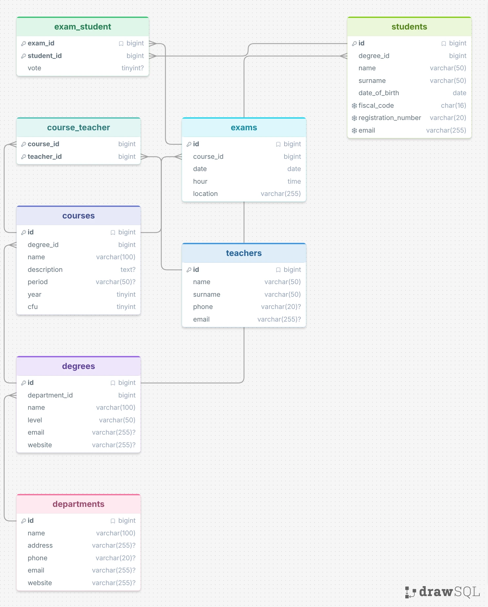

# db-university

Esercizio Boolean sui database e le relazioni tra tabelle: progettare lo schema di un'università (dipartimenti, corsi di laurea, corsi, insegnanti, appelli, studenti).
Lo schema è in `schema.sql` (MySQL 8, solo `CREATE TABLE`) e si può importare in drawSQL con File -> Import.

## Tabelle

- `departments`: i dipartimenti.
- `degrees`: i corsi di laurea, ognuno di un dipartimento.
- `courses`: i corsi (insegnamenti), ognuno di un corso di laurea.
- `teachers`: gli insegnanti.
- `course_teacher`: tabella ponte tra corsi e insegnanti.
- `exams`: gli appelli d'esame, ognuno di un corso.
- `students`: gli studenti, ognuno iscritto a un corso di laurea.
- `exam_student`: tabella ponte tra appelli e studenti, con il voto.

## Relazioni

- 1:N: un dipartimento ha più corsi di laurea; un corso di laurea ha più corsi e più studenti; un corso ha più appelli.
- N:N `courses` - `teachers`, tramite `course_teacher`: un corso ha più insegnanti e un insegnante più corsi.
- N:N `exams` - `students`, tramite `exam_student`: uno studente si iscrive a più appelli e un appello ha più studenti.

## Regola del voto

In `exam_student` la colonna `vote` può essere `NULL`: significa che lo studente è iscritto all'appello ma non ha partecipato. Un numero significa che ha partecipato, anche se il voto è insufficiente.

## Diagramma

Esportato da drawSQL:

